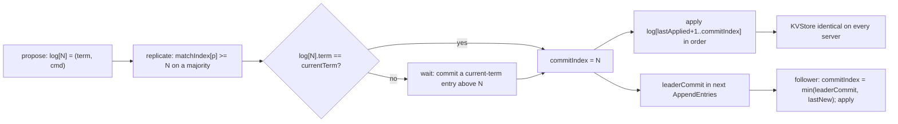

# Commit, Apply, and Linearizable Reads

**Stage 4 of 4.** Plan about 4 hours.

A replicated log is only useful once someone decides which prefix of it is *durable*: present on enough servers that no future leader can lack it. That decision is the commit rule (Figure 2, Leaders, last bullet): a leader may set `commitIndex = N` when a majority of `matchIndex` is at least `N` **and** `log[N].term == currentTerm`. The second condition is the subtle one. Figure 8 of the paper shows a leader that counts replicas of an older-term entry, declares it committed, crashes, and watches a new leader overwrite it. The fix is that a leader commits older entries only indirectly, by committing one of its own; that is why stage 3 appended a no-op on election. Followers learn the commit point from `leaderCommit` in every `AppendEntries` and advance to `min(leaderCommit, index of last new entry)`.

Once an index is committed every server applies `log[lastApplied + 1 .. commitIndex]` to its state machine in order (Figure 2, All Servers). Because all logs agree up to the commit point (Log Matching) and every server applies the same prefix in the same order, every `KVStore` passes through the same sequence of states: State Machine Safety. The client-facing result is **linearizability**: a `GET` that goes through the log sees every `PUT` that completed before it was invoked, from any client, on any node. This stage closes the loop by recording every client operation's invoke and return ticks and running a Wing-Gong checker, the one you built in the linearizability lesson, now over string registers and `PUT`/`GET`.

Payments is the natural home for this. The commands in the demo are `PUT balance:alice 75`; a ledger balance that two nodes disagree on is a reconciliation break, and a read that returns a balance from before a completed write is how double-spends start. Raft is the mechanism etcd, CockroachDB, TiKV, and the control planes of most payment platforms use to make "the write returned" mean "every future read will see it".



## Worked example

Five nodes, leader n0 in term 5, log `[1:t2 PUT x 1, 2:t2 PUT x 2]` left over from a dead term-2 leader. n0 wins the election, appends `3:t5 NOOP`, and starts replicating with `nextIndex = 3` for everyone.

| Step | Event | matchIndex (n1..n4) | commitIndex | Why |
|---|---|---|---|---|
| 1 | n1 and n2 reply success matchIndex 2 (they already had the term-2 entries; the no-op is still in flight) | 2, 2, 0, 0 | **0** | three of five hold index 2, but `termAt(2) = 2 != 5`: the current-term rule says no |
| 2 | client proposes `PUT x 3`, index 4, term 5 | | 0 | |
| 3 | n1 replies success matchIndex 4 | 4, 2, 0, 0 | 0 | only two of five hold index 4 |
| 4 | n2 replies success matchIndex 4 | 4, 4, 0, 0 | **4** | three hold index 4 and `termAt(4) = 5`: commit 4, which commits 1..3 with it |
| 5 | `applyCommitted` | | 4 | apply `PUT x 1`, `PUT x 2`, `NOOP`, `PUT x 3` in that order; `x = 3`, `lastApplied = 4` |
| 6 | next heartbeat carries `leaderCommit = 4` | | | n1 sets `commitIndex = min(4, 4) = 4`, applies the same four; n3, still catching up with only index 2, sets `min(4, 2) = 2` and applies two |

Had the leader committed at step 1, and then crashed before step 4, n3 or n4 (logs ending at `2:t2`, same term as everybody's last entry, so up-to-date) could have won term 6 and overwritten index 1..2 with their own term-6 entries. The applied `PUT x 2` would have vanished from a state machine that already acted on it. The no-op costs one log slot per election and makes the window close in one round trip.

Now the client view, on the quiet seed-7 cluster from stage 2 (leader n4, term 1):

| Op | Client | Command | Invoked | Returned | Result |
|---|---|---|---|---|---|
| #0 | alice | `PUT balance:alice 100` | 186 | 190 | OK |
| #1 | bob | `PUT balance:bob 50` | 186 | 190 | OK |
| #2 | alice | `PUT balance:alice 75` | 186 | 191 | OK |
| #3 | audit | `GET balance:alice` | 186 | 192 | 75 |

All four were invoked in the same tick, so they overlap and any order that the register model accepts is fine; the checker finds `#1, #0, #2, #3` (or any equivalent) and reports `LINEARIZABLE`. Now a history no correct Raft cluster can produce: `put(x=1) [0,5]`, `put(x=2) [6,10]`, `get(x)->1 [11,15]`. The read started after both writes returned, so both must be linearized before it, and then `x` is 2: `NOT LINEARIZABLE, longest prefix (2 of 3)`. Shift the second write to `[6,20]` so the read overlaps it and the same read of 1 becomes legal: the read may be placed before the write. That is the entire difference between a stale read and an allowed one, and it is measured in ticks the harness recorded.

How the harness records it (`Cluster.submit`, provided): the op goes to the stable leader, which `propose`s it; the op is pending at `(leaderId, index, term)`. Each tick, if that node's `lastApplied >= index` and `termAt(index)` still equals the proposing term, the op is **completed** with `returnedAt = now` and, for a `GET`, the result the state machine produced when it applied that entry. If the term at that index changed, the entry was overwritten by a new leader and the op is **failed**: the client is told the write did not happen, which is true. A `GET` through the log is a linearizable read because it occupies a committed slot; cheaper read paths (ReadIndex, leases) are the going-further exercise.

## Your task

Finish `RaftNode.java`, implement `KVStore.apply`, and implement `Checker` in `Linearizability.java`.

```java
// RaftNode
void advanceCommitIndex(int now);     // leader only: for N from lastLogIndex() down to commitIndex+1:
                                      //   if termAt(N) == currentTerm && replicatedCount(N) >= majority(): commitIndex = N; applyCommitted(now); return
void applyCommitted(int now);         // while lastApplied < commitIndex: lastApplied++; stateMachine.apply(log[lastApplied].command())
List<Message> onAppendReply(...);     // after a matchIndex advance, call advanceCommitIndex(now)
List<Message> onAppendEntries(...);   // rule 5: if m.leaderCommit() > commitIndex: commitIndex = min(m.leaderCommit(), lastNew); applyCommitted(now)

// KVStore
String apply(String command);         // "PUT k v" -> "OK"; "GET k" -> value or ""; "NOOP" -> ""; else IllegalArgumentException
                                      // record command and result in appliedCommands / results

// Checker
CheckResult check(History history);                       // ok, witness order, longest prefix, states explored
static Map<String, String> step(Map<String, String> state, Op op);   // PUT -> new map with the write; GET -> same map if value matches, else null
```

Rules:

- **`advanceCommitIndex`** scans from the top so one call commits the highest eligible index; everything below it commits implicitly. It never commits an index whose term is not `currentTerm`, however many replicas hold it. Call it only after `matchIndex` moved forward; calling it on a non-leader must do nothing.
- **`applyCommitted`** applies strictly in index order and never past `commitIndex`. `stateMachine.appliedCommands` must therefore equal `log[1..lastApplied]` command for command on every node, always; the tests check that invariant on every node after every scenario.
- **Follower rule 5** uses `lastNew = prevLogIndex + entries.size()`, not `lastLogIndex()`: a follower that holds uncommitted entries beyond what this message confirmed must not commit them on the strength of the leader's number. `commitIndex` never decreases; a refused `AppendEntries` (consistency check failed) never touches it.
- **Restart** rebuilds everything: `commitIndex = 0`, `lastApplied = 0`, empty `KVStore`; the next `AppendEntries` with `leaderCommit` re-applies the persisted log from the start. The harness does this for you by constructing a new `RaftNode` on the old `Storage`; your code just has to not assume anything volatile survived.
- **`KVStore.apply`**: split on single spaces into at most three parts, so a `PUT` value may contain spaces (`PUT note hello world` stores `hello world`). `PUT` needs a non-empty key and a value, `GET` exactly a key, `NOOP` nothing; anything else throws `IllegalArgumentException` *before* recording. `GET` of an absent key returns `""` (and `get()` returns `null`).
- **`Checker.step`** is the sequential specification over a `Map<String, String>` of registers, each initially absent (`""`). It never mutates its input: return a new `TreeMap` for a `PUT`, the same map for an accepted `GET`, `null` for a rejected one.
- **`Checker.check`** is the Wing-Gong search with Lowe's memo, as in the linearizability lesson: depth-first over the set of not-yet-linearized ops; an op may go next only if no unlinearized op `precedes` it (returned before it was invoked); memoise failed `(linearized set, state)` configurations; track the longest prefix ever reached for the failure report and count explored states. `History` caps at 62 ops so the linearized set fits in a `long`.

The commit rule, in full, since every word of it is load-bearing:

```java
void advanceCommitIndex(int now) {
    if (role != Role.LEADER) return;
    for (int n = lastLogIndex(); n > commitIndex; n--) {
        if (storage.termAt(n) != storage.currentTerm) continue;      // section 5.4.2: never by counting
        if (replicatedCount(n) >= majority()) {
            commitIndex = n;                                          // commits everything below n as well
            applyCommitted(now);
            return;
        }
    }
}

void applyCommitted(int now) {
    while (lastApplied < commitIndex) {
        lastApplied++;
        stateMachine.apply(storage.log.get(lastApplied).command());
    }
}
```

The checker's search, with the three places that make it correct marked:

```java
private boolean search(long done, Map<String, String> state) {
    explored++;
    if (order.size() > longestPrefix.size()) longestPrefix = new ArrayList<>(order);
    if (Long.bitCount(done) == ops.size()) return true;
    String memoKey = done + "|" + state;                               // (1) Lowe's memo: same set, same state, same answer
    if (failedConfigs.contains(memoKey)) return false;
    for (int i = 0; i < ops.size(); i++) {
        if ((done & (1L << i)) != 0 || !mayGoNext(i, done)) continue;  // (2) real-time: nothing unlinearized precedes i
        Map<String, String> next = step(state, ops.get(i));            // (3) the sequential spec says yes or no
        if (next == null) continue;
        order.add(i);
        if (search(done | (1L << i), next)) return true;
        order.remove(order.size() - 1);
    }
    failedConfigs.add(memoKey);
    return false;
}
```

`mayGoNext(i, done)` returns false if any op `j` not in `done` has `ops.get(j).precedes(ops.get(i))`. The lesson's checker took a `Consistency` parameter and an integer register; this one is linearizable-only over string keys, which is all a key-value service needs.

Bugs this stage's tests are built to expose:

| Bug | What you will see |
|---|---|
| Commit rule without the term check | "term-2 entries on 3/5 replicas do NOT commit" fails; the lossy seeds eventually throw STATE MACHINE SAFETY |
| Scan from the bottom and stop at the first non-majority index | commit stalls below a committed index when one follower is behind on a middle entry |
| Follower uses `lastLogIndex()` for the cap | "leaderCommit beyond what the follower holds is capped at the last new entry" passes, but the stale-leader scenario applies the 999 write on the stale node before heal |
| Apply skips `NOOP` or applies out of order | `appliedPrefixMatchesLog` fails on every scenario |
| `KVStore` splits on all spaces | "a PUT value may contain spaces" fails |
| Checker mutates `state` in `step` | "step applies a PUT to a copy" fails; later, backtracking sees writes that were undone |
| Checker ignores real time | the stale read is reported linearizable; the checker is useless |
| Memo key omits the state | still correct, but the 12-seed scenario explores orders of magnitude more states and may time out |

What must fail and how: counting replicas of an older-term entry must not advance `commitIndex` (the standalone 5.4.2 test, three replicas, term-2 entries under a term-5 leader). Three crashed nodes out of five must leave a proposal uncommitted and unapplied everywhere until one comes back. A write accepted by a partitioned stale leader must end in `Cluster.failed`, never in any `KVStore`. `KVStore.apply` on garbage throws and records nothing. `Checker.check` on a stale read returns `ok == false` with an empty `order` and a two-op `longestPrefix`; the empty history is linearizable.

Python and Go ports of this project follow later; this pass is Java only.

## Run the grader

```bash
python3 scripts/project_test.py raft-kv --lang java --stage 4 --path my-raft-kv
python3 scripts/project_test.py raft-kv --lang java --all --path my-raft-kv --report raft-kv-report.json
```

All four stages run. Stage 4 has about 66 assertions: `KVStore` semantics and rejections, leader commit by majority with ordered apply, the section 5.4.2 scenario, follower commit capping and monotonicity, four client ops with a read of 75 and a linearizable history, commit blocked by three crashes and released by one restart, a restart that rebuilds the store from the log, the stale leader whose write fails and is never applied, the checker's specification and six hand-built histories, and 12 lossy seeds with a leader crash where every history must be linearizable and every state machine must converge on the same applied prefix.

## Check yourself

1. Explain the Figure 8 schedule in your own words, with the five nodes above, and point to the single line in `advanceCommitIndex` that prevents it.
2. Why is `GET` put through the log at all? What would break if the leader answered reads from its local `KVStore` without a log slot, and what extra check (section 8 of the paper) would make that safe?
3. The harness marks an op failed when the term at its index changed. Could a `PUT` that the harness reports as failed nonetheless be visible in some node's `KVStore`? Argue from State Machine Safety.

## Going further

Snapshotting and membership change (Raft III, lesson 07) are the next mechanisms: `Storage.truncate` from the *front* once `lastApplied` passes a threshold, with `KVStore` serialised as the snapshot, and joint consensus for adding a node without a window of two majorities. On the payments side, replace `PUT balance:alice 75` with a balanced journal entry from the Ledger Engine project and make the state machine refuse to apply an entry that would overdraw: a replicated ledger whose invariant holds on every node by construction.
